## 简介

AI 开发者空间是面向开发者的智能开发工作空间，以 AI SHELL 为核心入口，通过自然语言交互和命令行两种模式，打通云资源操作、智能代码生成、多 Agent 协作、基础设施即代码（IaC）部署、消息渠道对接、隧道托管与远程连接等全链路开发能力，帮助开发者在统一工作台中高效完成云原生应用的开发、部署与运维。

### 核心能力

模块| 说明  
---|---  
**AI SHELL**|  核心入口，支持 AI 对话、TUI、命令行三种交互模式  
**AGENTS**|  9 个智能体，覆盖代码编写与分析、多 Agent 协作、DeepSeek 推理、编程辅助、个人助手、任务调度编排、AI 教学辅助等场景  
**环境管理**|  14 个作业环境，支持智能体、开发工具、数据库、基础设施四类分类，一键部署与管理  
**AGENT WORK**|  智能体工作平台（Beta），包含 Agent 管理、项目、任务、小队、自动化 5 个子模块，覆盖从 Agent 定义、任务承载、多智能体协作到周期自动化的完整工作流  
**EXTENSIONS**|  扩展能力，包含华为云 Skills（79 个云服务技能）和 Channels（飞书/微信/企业微信对接）  
**TOOLS**|  开发辅助工具：OpenViking 代码理解与重构、DevBridge 隧道管理  
**RESOURCES**|  资源入口：文档站（本操作指南）与 Agent 接入（IACMCPServer 使用指南）  
**文件管理**|  工作区文件操作：搜索、批量处理、上传、新建文件/文件夹，右侧面板快速访问  
**设置与反馈**|  账号信息与主题设置（浅色 / 深色 / 跟随设备），以及问题反馈入口  
**视频指导**|  核心功能与实操方法的视频教程，支持按 CodeArts、AgentWork、WorkSwarm、作业环境、DevBridge、OpenViking 分类筛选查看  
  
### 为什么需要 AI 开发者空间

在华为云上进行开发与运维时，开发者常遇到以下挑战：

  * **云资源操作门槛高** ：ECS、CCE、OBS 等服务 API 与 CLI 命令繁多，学习成本高
  * **自然语言到命令的转换难** ：想把想法落地为可执行的云操作命令，需要大量检索与试错
  * **代码理解与重构成本高** ：大型项目中代码逻辑复杂，缺乏智能化的代码分析与重构建议支持
  * **多云 IaC 编排学习曲线陡峭** ：多云资源编排需要掌握不同云平台的 IaC 语法，切换成本高
  * **隧道与远程连接配置复杂** ：本地开发环境与云环境的安全连接配置繁琐，端口管理与转发耗时
  * **能力分散** ：代码智能体、多 Agent 协作、IaC 部署、隧道管理等工具散落各处，难以协同
  * **多平台集成繁琐** ：难以将 AI 能力接入飞书、微信、企业微信等消息平台

## 首页

登录 AI 开发者空间后默认进入首页。页面左侧为全局导航（AGENTS、环境管理、EXTENSIONS、TOOLS、RESOURCES、文件管理、设置与反馈），右侧为资源管理器面板；主区域从上到下分为四个板块：

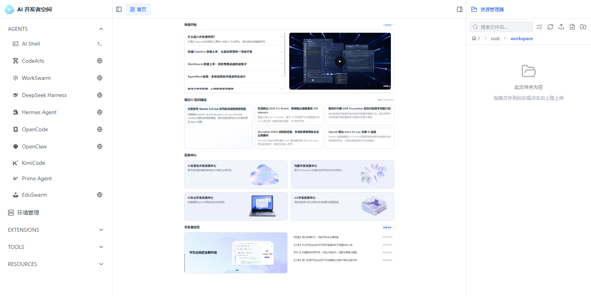

AI 开发者空间首页总览

板块| 说明  
---|---  
**快速开始**|  产品与核心功能的视频教程列表（什么是 AI 开发者空间、码道 CodeArts、WorkSwarm、AgentWork 等），点击即可在线播放  
**每日AI知识精选**|  每日更新的大模型与 AI 领域精选资讯，涵盖前沿模型发布、技术进展与实践案例  
**实践中心**|  AI 云原生、鸿蒙、AI 办公、IaC 四大开发实践中心，按场景提供端到端的开发实践资源  
**开发者动态**|  华为云开发者活动、任务福利与平台最新动态  
  
## AI SHELL

**AI SHELL** 是产品的核心入口，秉持“智驱华为云，对话即部署”的产品理念，大模型驱动，支持自然语言对话、智能排错与云端在线终端，提供三种交互模式：

模式| 用途| 说明  
---|---|---  
**AI 对话**|  自然语言交互| 用自然语言描述需求，AI 生成命令并执行（默认模式）  
**TUI**|  终端交互| 终端界面（Terminal UI），面向习惯终端操作的开发者  
**命令行**|  命令式操作| 面向熟悉 CLI 的开发者，直接输入命令  
  
**操作步骤：**

  1. 在左侧 **AGENTS 概览** 下点击 **AI SHELL** ，进入 AI 对话界面
  2. 点击 **「新建」** 创建会话，可指定工作目录（CWD），缺省为 `/root/workspace`
  3. 在输入框用自然语言描述需求（例如"查询所有运行中的 ECS 实例"），按 Enter 发送（Shift+Enter 换行）
  4. 输入 `/mode` 可随时切换「AI 对话」「TUI」「命令行」模式

AI SHELL 主界面：居中欢迎页、快捷建议与需求输入框

**输入增强：**

  * 输入 `/` 触发快捷指令：`/clear`、`/compact`、`/cwd`、`/help`、`/mode`、`/model`、`/new`、`/rename`、`/sessions`、`/settings`
  * 输入 `$` 快速引用技能
  * 右侧资源管理器中可将文件「添加到对话」作为上下文

点击输入框左下方的 `mode: Semi-Auto` 按钮，可打开会话配置：

配置项| 说明| 可选值  
---|---|---  
**Session Mode**|  控制 AI 的自主性与安全边界| Auto / Semi-Auto（默认）/ Manual / Plan  
**Reasoning Level**|  控制模型产生的推理量| Low / Medium（默认）/ High  
**Model**|  选择使用的 LLM 模型| hwdevspace/deepseek-v4-flash-0731（默认）/ hwdevspace/deepseek-v4-pro-0813 / hwdevspace/glm-5.1 / hwdevspace/glm-5.2  

会话配置面板：Session Mode / Reasoning Level / Model

## AGENTS 概览

**AGENTS** 模块默认展示 CodeArts、WorkSwarm、DeepSeek Harness 智能体，根据部署的环境状态动态展示 Agent 入口， 目前可以提供 9 个智能体，覆盖代码生成、多 Agent 协作、个人助手、DeepSeek 模型推理、AI 教学辅助等场景。 

## CodeArts

**CodeArts** 是华为云码道代码智能体 CLI，支持代码编写、分析与优化。支持 **TUI（终端模式）** 和 **WebUI（网页模式）** 两种使用方式。

**操作步骤：**

  1. 点击左侧菜单 **CodeArts** ，进入该智能体
  2. 选择使用模式：**TUI** （点击名称直接进入终端界面）或 **WebUI** （点击右侧 WebUI 按钮进入网页界面）
  3. 在 TUI 终端或 WebUI 网页中输入代码编写、分析或优化需求
  4. CodeArts 生成代码建议或分析报告，确认后执行查看结果

### TUI 模式（终端界面）

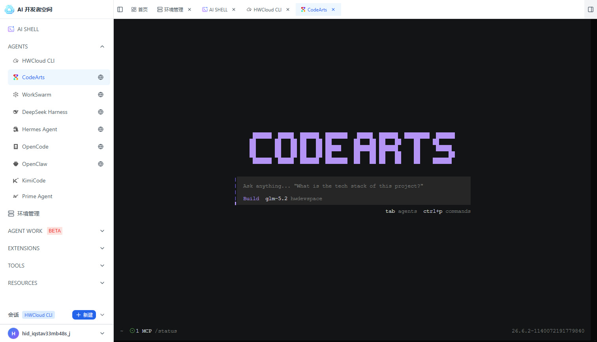

CodeArts TUI：终端模式，直接在命令行中交互

### WebUI 模式（网页界面）

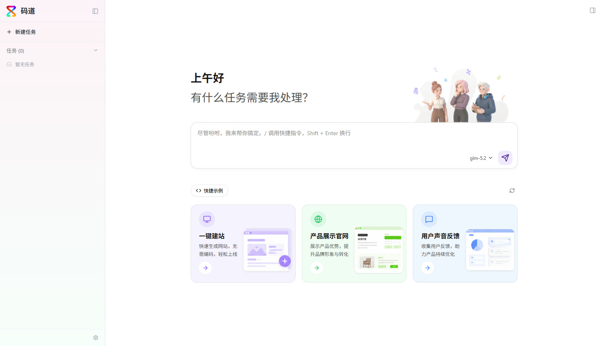

CodeArts WebUI：网页模式，可视化操作界面

## WorkSwarm

**WorkSwarm** 是多 Agent 协作框架，可自动将复杂任务分解并分配给不同 Agent 协作完成。支持 **TUI（终端模式）** 和 **WebUI（网页模式）** 两种使用方式。

**操作步骤：**

  1. 点击左侧菜单 **WorkSwarm** ，进入该智能体
  2. 选择使用模式：**TUI** （点击名称直接进入终端界面）或 **WebUI** （点击右侧 WebUI 按钮进入网页界面）
  3. 输入一个复杂任务
  4. WorkSwarm 自动分解任务并分配给不同 Agent 协作处理
  5. 查看各 Agent 的协作结果

### TUI 模式（终端界面）

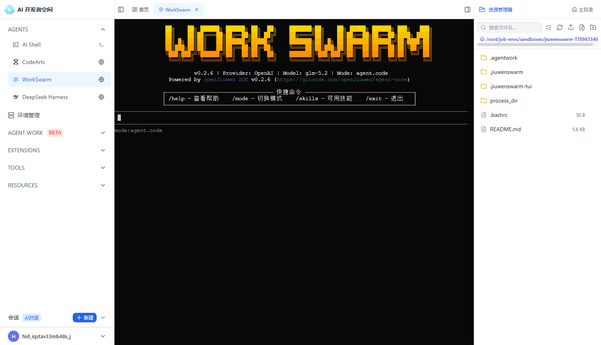

WorkSwarm TUI：终端模式

### WebUI 模式（网页界面）

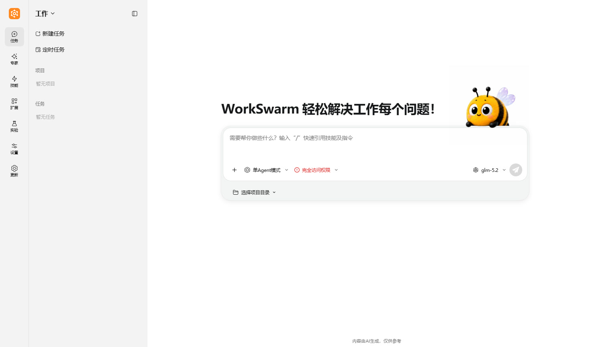

WorkSwarm WebUI：网页模式，多 Agent 可视化协作

## DeepSeek Harness

**DeepSeek Harness** 是基于 DeepSeek 大模型的 AI 推理智能体，支持高效模型推理、代码生成与自然语言理解，可无缝集成到开发工作流中。支持 **TUI（终端模式）** 和 **WebUI（网页模式）** 两种使用方式。

**操作步骤：**

  1. 点击左侧菜单 **DeepSeek Harness** ，进入该智能体
  2. 选择使用模式：**TUI** （点击名称直接进入终端界面）或 **WebUI** （点击右侧 WebUI 按钮进入网页界面）
  3. 输入推理、代码生成或分析需求
  4. DeepSeek Harness 调用模型进行推理并返回结果
  5. 查看推理结果，根据需要调整提示词并重新执行

### TUI 模式（终端界面）

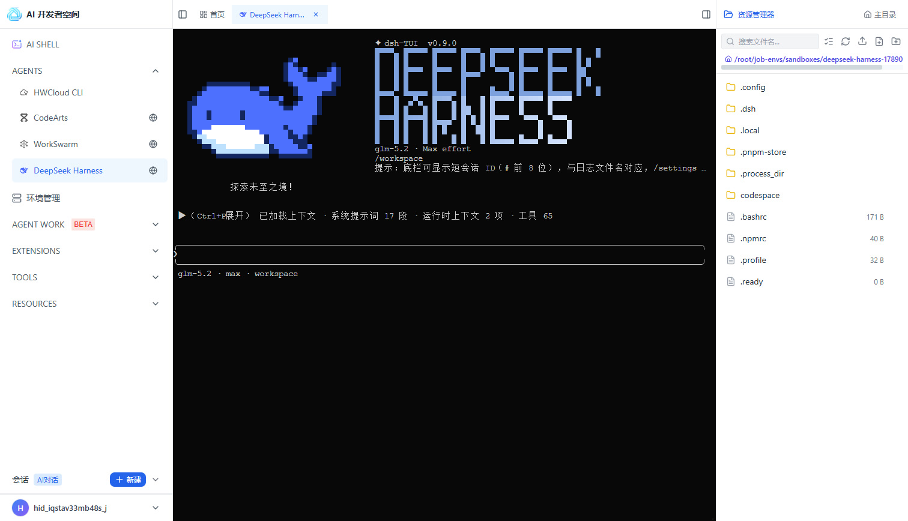

DeepSeek Harness TUI：终端模式

### WebUI 模式（网页界面）

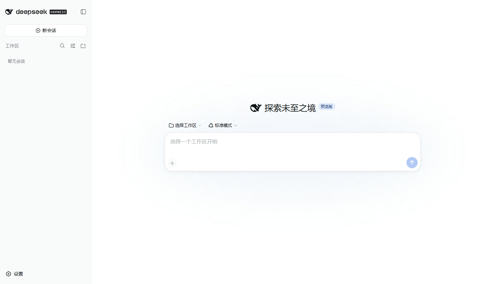

DeepSeek Harness WebUI：网页模式，支持会话编排与技能管理

## Hermes Agent

**Hermes Agent** 是自我改进型 AI Agent，内置学习循环与长期记忆，可持续优化自身行为。

**操作步骤：**

  1. 点击左侧菜单 **Hermes Agent** ，进入该智能体
  2. 输入需要处理或改进的任务
  3. Hermes Agent 通过学习循环与长期记忆进行自我改进
  4. 查看改进后的结果

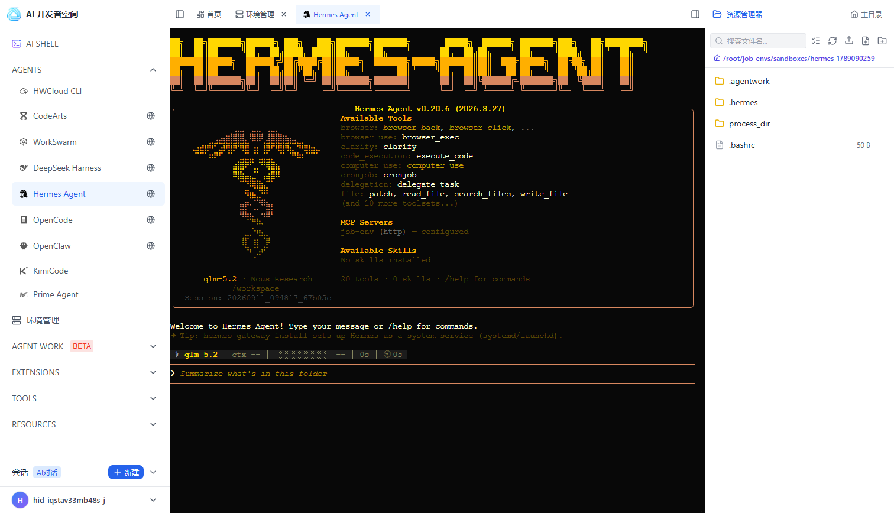

Hermes Agent：自我改进型 AI Agent

## OpenCode

**OpenCode** 是开源 AI 编程代理，可连接任意模型完成编程任务。

**操作步骤：**

  1. 点击左侧菜单 **OpenCode** ，进入该智能体
  2. 连接目标模型
  3. 描述编程任务
  4. 查看生成的代码并确认执行

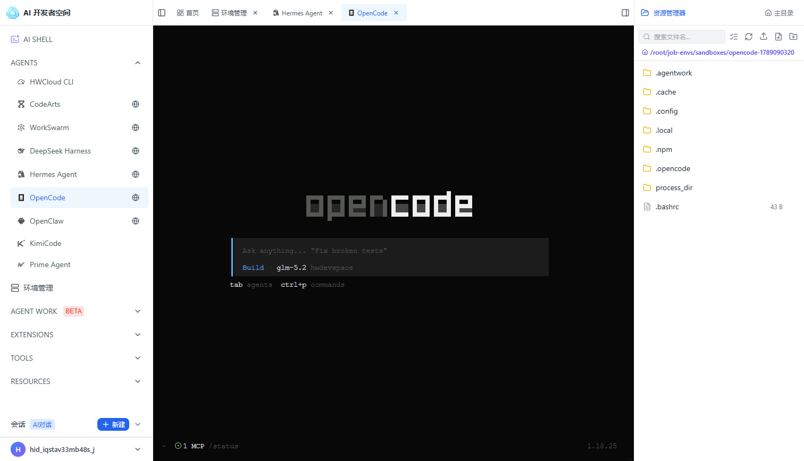

OpenCode：开源 AI 编程代理

## OpenClaw

**OpenClaw** 是开源可编程 AI 个人助手平台，支持多渠道消息接入与自动化任务处理，可处理各类个人任务。支持 **TUI（终端模式）** 和 **WebUI（网页模式）** 两种使用方式。

**操作步骤：**

  1. 点击左侧菜单 **OpenClaw** ，进入该智能体
  2. 选择使用模式：**TUI** （点击名称直接进入终端界面）或 **WebUI** （点击右侧 WebUI 按钮进入网页界面）
  3. 配置个人助手参数与渠道接入
  4. 输入任务，OpenClaw 自动执行并返回结果
  5. 查看执行结果，可根据需要调整配置并重新执行

### TUI 模式（终端界面）

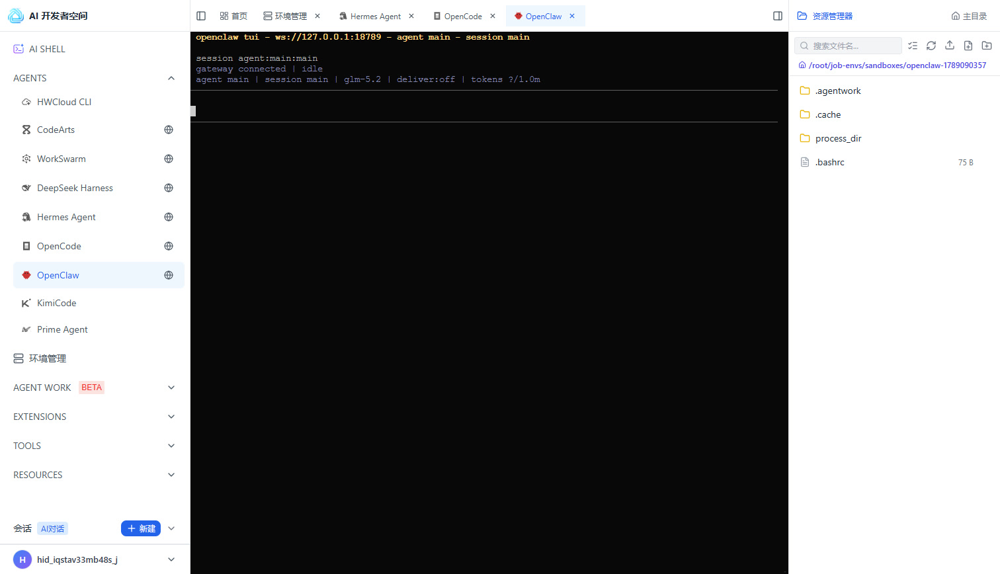

OpenClaw TUI：终端模式，命令行交互

### WebUI 模式（网页界面）

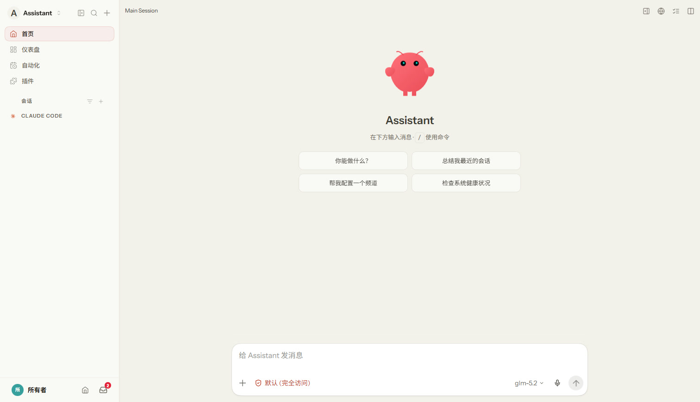

OpenClaw WebUI：网页模式，可视化管理个人助手与渠道配置

## KimiCode

**KimiCode** 是智能编程服务，支持代码阅读、编辑与命令执行。

**操作步骤：**

  1. 点击左侧菜单 **KimiCode** ，进入该智能体
  2. 描述代码阅读、编辑或命令执行需求
  3. KimiCode 执行并返回结果
  4. 查看执行结果

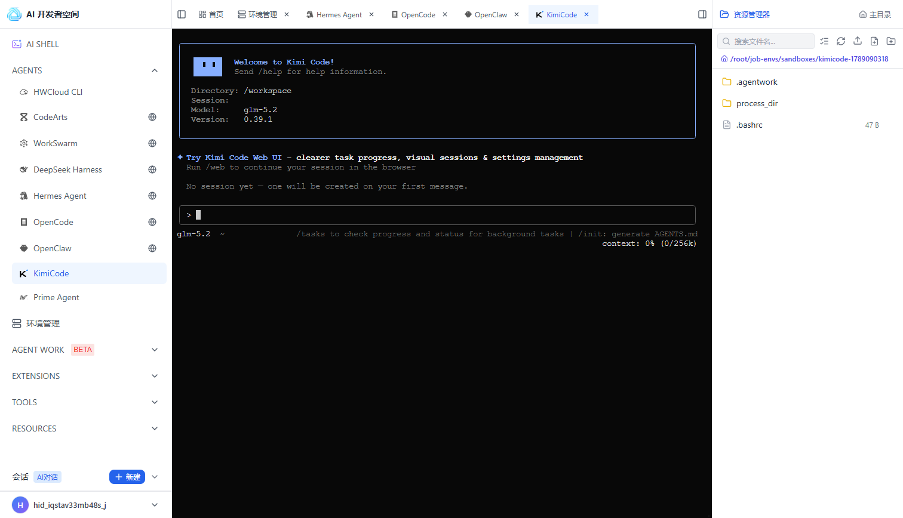

KimiCode：智能编程服务

## Prime Agent

**Prime Agent** 是智能任务调度与编排 Agent，支持将复杂任务自动拆解为子任务并协调多个执行单元协同完成。

**操作步骤：**

  1. 点击左侧菜单 **Prime Agent** ，进入该智能体
  2. 输入需要处理的复杂任务或编排需求
  3. Prime Agent 自动拆解任务并协调执行单元进行处理
  4. 查看各子任务的执行结果与整体编排状态

## EduSwarm

**EduSwarm** 是 AI 教师团队协作平台（AI 智慧课堂工作台），提供备课、上课、作业、批改、学情全流程 AI 辅助。内置今日课堂、课堂管理、班级管理、课件中心、作业中心、批改报告、教学总览、Agent 配置与统计、Edu SkillHub、Studio、学生端等功能模块，支持任务编排与定时任务。

**操作步骤：**

  1. 点击左侧菜单 **EduSwarm** ，进入 AI 智慧课堂工作台
  2. 首次进入可跟随操作指引分步熟悉核心流程，或点击「跳过引导」直接开始
  3. 通过左侧功能栏进入今日课堂、课件中心、作业中心等模块，也可在输入框用自然语言直接下达教学任务
  4. 通过输入框下方可配置单 Agent 模式、访问权限与技能，选择模型后发送，EduSwarm 协同 AI 教师团队完成任务并输出结果

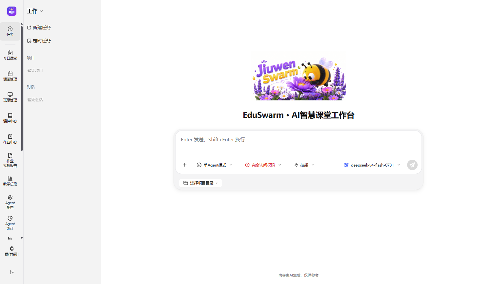

EduSwarm：AI 智慧课堂工作台

## TOOLS

**TOOLS** 模块提供开发辅助工具，默认部署以下工具：

工具| 说明  
---|---  
**OpenViking**|  智能开发辅助工具，提供代码理解、重构建议与自动化开发支持  
**DevBridge**|  隧道管理工具，提供 Web 控制台，支持隧道创建、端口管理与远程访问  
  
## OpenViking

**OpenViking** 是智能开发辅助工具，帮助开发者理解代码、提供重构建议与自动化开发支持。支持 **TUI（终端模式）** 和 **WebUI（网页模式）** 两种使用方式。

**操作步骤：**

  1. 点击左侧菜单 **TOOLS → OpenViking** ，进入该工具
  2. 选择使用模式：**TUI** （点击名称直接进入终端界面）或 **WebUI** （点击右侧 WebUI 按钮进入网页界面）
  3. 选择目标代码文件或项目目录
  4. OpenViking 分析代码并生成理解报告或重构建议
  5. 确认建议后执行相应操作

### TUI 模式（终端界面）

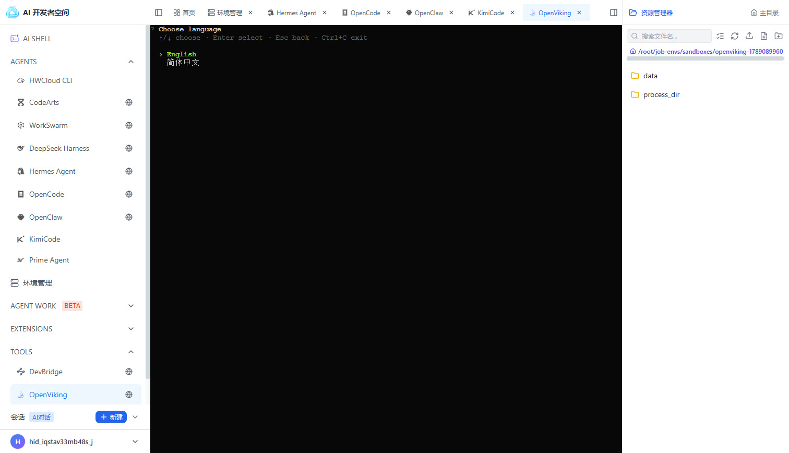

OpenViking TUI：终端模式，选择语言初始界面

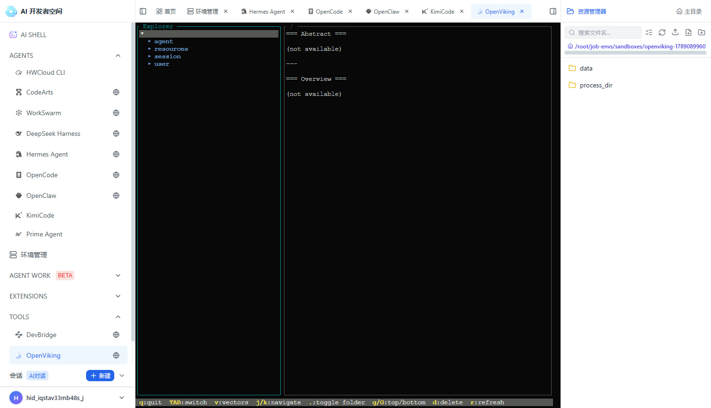

OpenViking TUI：选择中文语言后的界面展示

### WebUI 模式（网页界面）

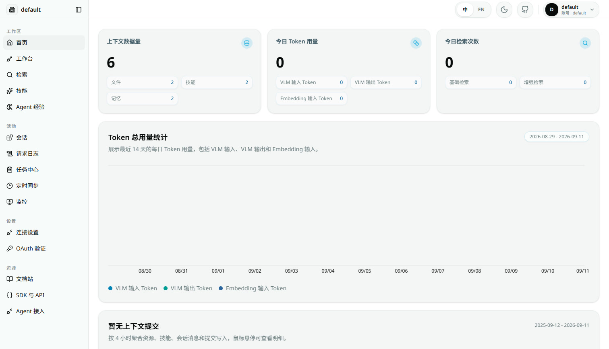

OpenViking WebUI：网页模式，代码智能助手

## DevBridge

**DevBridge** 是隧道管理工具，提供开发者隧道能力，支持托管（Host）将本地端口服务暴露到公网隧道，以及连接（Connect）将远端隧道端口转发到本地。支持 **TUI（终端模式）** 和 **WebUI（网页模式）** 两种使用方式。当在**环境管理** 中部署 DevBridge 环境后，会在 **TOOLS** 菜单下展示入口。

**操作步骤：**

  1. 在 **环境管理** 中部署 **DevBridge** 环境
  2. 部署完成后，左侧 **TOOLS** 菜单下会出现 **DevBridge** 入口
  3. 选择使用模式：**TUI** （点击名称直接进入终端界面）或 **WebUI** （点击右侧 WebUI 按钮进入管理控制台）
  4. TUI 模式下可通过命令行管理隧道；WebUI 模式下可在控制台创建隧道、管理端口映射与托管/连接进程

### TUI 模式（终端界面）

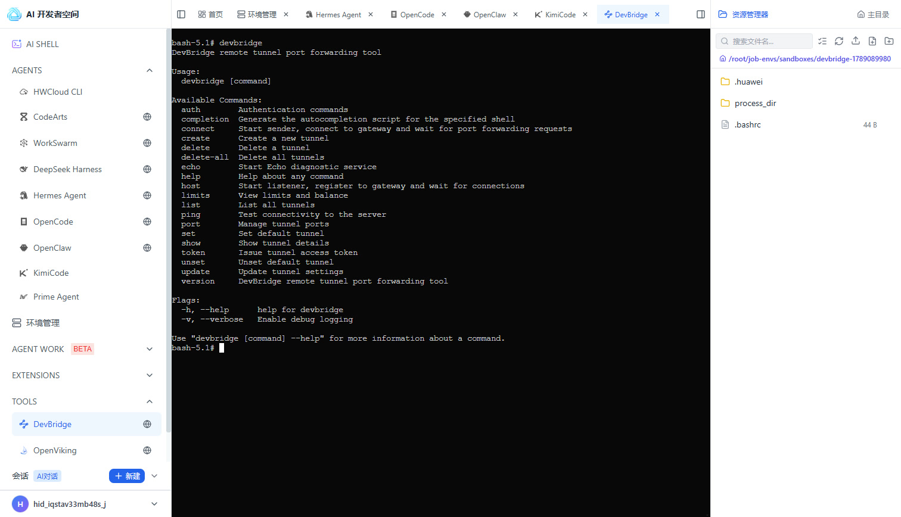

DevBridge TUI：终端模式，通过命令行管理隧道

### WebUI 模式（网页界面）

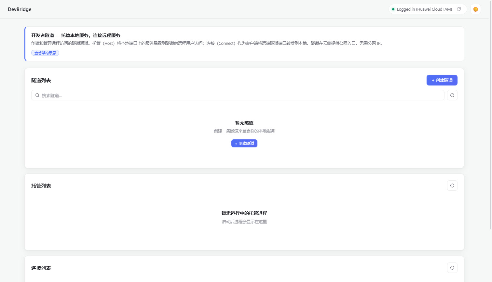

DevBridge WebUI：隧道管理控制台，可视化创建和管理隧道

## 环境管理

环境管理用于浏览和部署各类作业环境，支持搜索与分类筛选：

分类| 说明  
---|---  
智能体（11）| 代码智能体、多 Agent 协作、个人助手、AI 教学辅助等 11 个智能体环境  
开发工具（6）| DevBridge 隧道管理、IAC MCP Server、Agent Browser、HuaweiCloud DevKit、Next AI Draw.io、鸿蒙开发环境  
数据库（1）| OpenViking AI 智能体开源上下文数据库  
基础设施（1）| Llama 本地 Embedding 环境  
  
共 19 个环境，12 运行中，支持的作业环境：

环境| 类型| 版本| 说明  
---|---|---|---  
**AI Shell**|  智能体| 内置| AI Shell · 智驱华为云，对话即部署（TUI）  
**HWCloud CLI**|  智能体| v1.0.5| 基础设施即代码智能体，支持 Terraform、Ansible 等自动化工具  
**CodeArts**|  智能体| v1.0.10| 华为云码道代码智能体，支持代码编写、分析、优化（TUI / WebUI）  
**WorkSwarm**|  智能体| v1.0.9| 多 Agent 协作框架，自动分解问题并分配给不同 Agent  
**DeepSeek Harness**|  智能体| v1.0.9| DeepSeek 官方多代理智能体开发平台，支持会话编排、技能管理、多模型接入  
**Hermes Agent**|  智能体| v1.0.5| Nous Research 自我改进型 AI Agent，内置学习循环与长期记忆  
**OpenCode**|  智能体| v1.0.5| 开源 AI 编程代理，可连接 Claude、GPT、Gemini 等任意模型  
**OpenClaw**|  智能体| v1.0.4| 开源可编程 AI 个人助手平台，支持自动化任务、工具调用  
**KimiCode**|  智能体| v1.0.4| 智能编程服务，支持代码阅读、编辑、命令执行、网页搜索（仅 TUI）  
**Prime Agent**|  智能体| v1.0.4| 智能任务调度与编排 Agent，自动拆解复杂任务并协调多执行单元协同（仅 TUI）  
**EduSwarm**|  智能体| v1.0.3| AI 教师团队协作平台，覆盖备课、上课、作业、批改、学情全流程（仅 WebUI）  
**DevBridge**|  开发工具| v1.0.1| 隧道管理工具，支持网络隧道创建、端口管理与远程连接  
**IAC MCP Server**|  开发工具| —| 云部署 IaC 助手，覆盖需求分析、资源规划、成本估算、Terraform 部署、排错与资源销毁全流程（未部署）  
**Agent Browser**|  开发工具| —| 无头浏览器自动化环境（未部署）  
**HuaweiCloud DevKit**|  开发工具| —| 华为云开发套件，构建、部署、运维全程受控（未部署）  
**Next AI Draw.io**|  开发工具| —| AI 自然语言生成 Draw.io 图表（未部署）  
**鸿蒙开发环境**|  开发工具| —| 基于 GLM 模型鸿蒙增训、深度适配 ArkTS 语言，支持云端编译打包，支持云端 + 本地模拟器调测（待开放）  
**OpenViking**|  数据库| v1.0.2| AI 智能体的开源上下文数据库  
**Llama**|  基础设施| —| 基于 llama.cpp 的本地 Embedding 环境，内置 bge-small-zh-v1.5 向量模型（未部署）  
**SRE**|  智能体| —| 环境运维、故障排查、扩缩容规划、费用查询（待开放）  
  
**操作步骤：**

  1. 点击左侧 **环境管理** 进入环境列表
  2. 使用顶部**搜索框** 检索环境，或按分类（智能体 / 开发工具 / 数据库 / 基础设施）筛选
  3. 每个环境提供 **TUI** （终端界面）或 **WebUI** （网页界面）入口
  4. 支持**停止** 、**删除** 操作，部分环境支持**升级**

环境管理：作业环境列表、分类筛选与 TUI / WebUI 入口

## AGENT WORK

**AGENT WORK** （Beta）是智能体工作平台，提供从 Agent 定义、任务承载、多智能体协作到周期自动化的完整工作流。在左侧导航展开 **AGENT WORK** 菜单，包含 5 个子模块：

子模块| 说明  
---|---  
**Agent 管理**|  创建和管理自定义 AI Agent，配置人格、模型与运行时  
**项目**|  承载 Agent 任务的容器，定义标准与验证规则，支持关联代码仓库自动校验  
**任务**|  Agent 任务目标管理，跟踪任务执行状态与进度  
**小队**|  将多个智能体组合为协作小队，由 Leader 协同完成复杂任务  
**自动化**|  为智能体或小队安排周期性任务  
  
## Agent 管理

管理空间内的 AI Agent 实例。内置 **AI SHELL** Agent 默认在线，支持通过 **聊天** 直接对话，或通过 **IM 连接** 接入即时消息渠道：

  1. 点击左侧 **AGENT WORK → Agent 管理** 进入 Agent 列表
  2. 使用顶部**搜索框** 按名称、模型检索 Agent，点击 **我的 SKILL** 查看可用技能
  3. 点击 **\+ 创建 Agent** ，填写 Agent 名称与人格，选择运行时，可配置环境变量、Skills 与 MCP 服务器
  4. 通过**快速入口** 开关控制 Agent 展示，使用 **聊天** / **IM 连接** 快捷操作

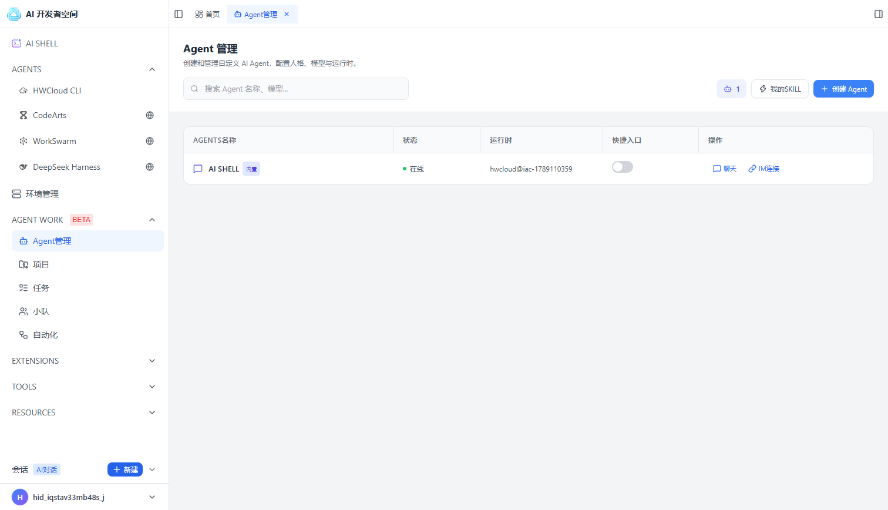

Agent 管理：Agent 列表、状态与运行时监控、聊天 / IM 连接入口

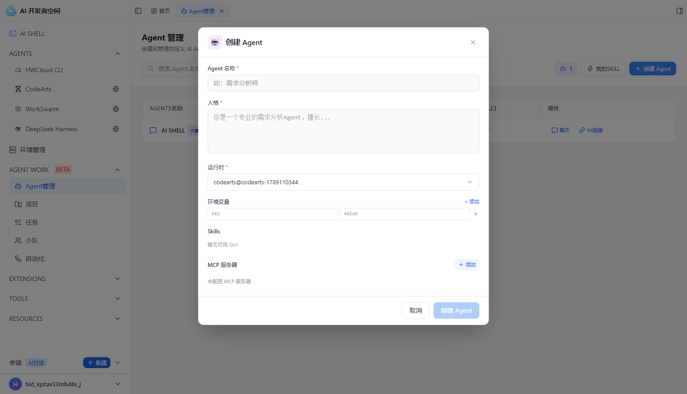

创建 Agent：填写名称与人格，选择运行时，可配置环境变量、Skills 与 MCP 服务器

## 项目

项目是承载 Agent 任务的容器，可定义标准与验证规则，支持关联代码仓库自动校验：

  1. 点击左侧 **AGENT WORK → 项目** 进入项目列表
  2. 点击 **\+ 新建项目** （首次使用可点击 **\+ 创建第一个项目** ），选择项目类型（**无仓库项目** / **代码仓库** ），填写项目名称与验收要求
  3. 支持按项目名称搜索与筛选

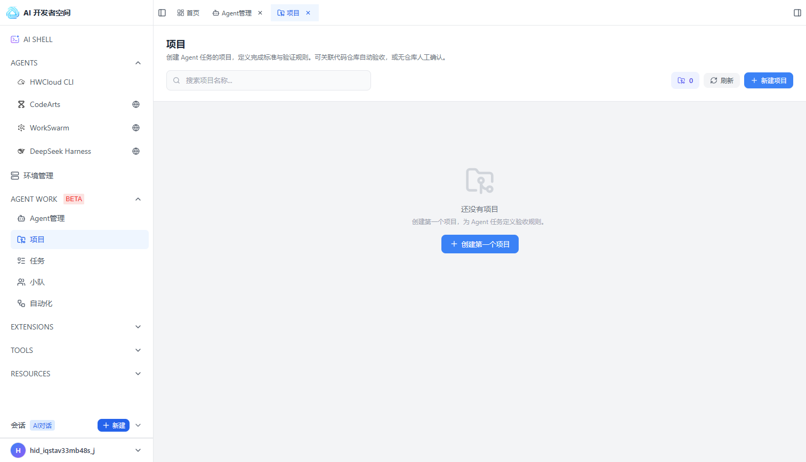

项目：承载 Agent 任务的容器，创建后可为任务定义验证规则

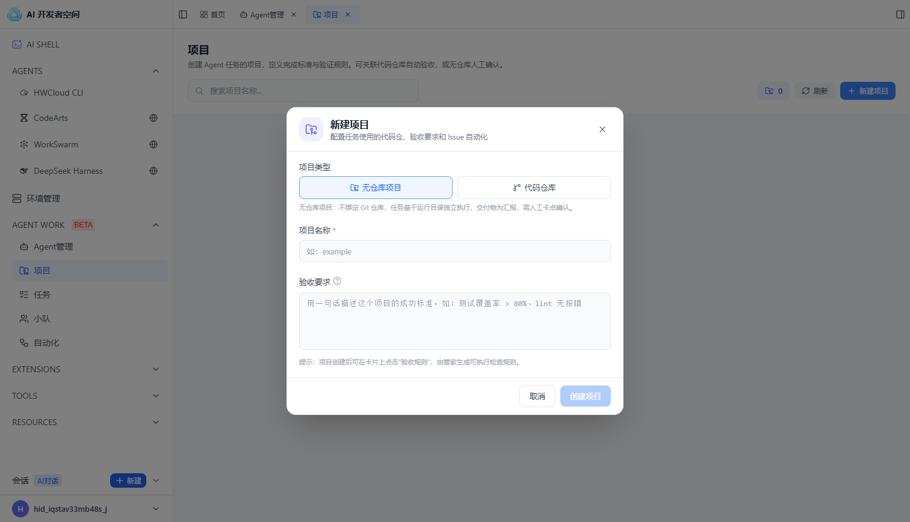

新建项目：选择项目类型（无仓库项目 / 代码仓库），填写项目名称与验收要求

## 任务

面向目标的任务管理，实时跟踪 Agent 执行状态与进度：

  1. 点击左侧 **AGENT WORK → 任务** 进入任务列表
  2. 点击 **\+ 新建任务** （首次使用可点击 **\+ 创建第一个任务** ），填写标题与描述，选择负责人（Agent 或小队）与所属项目
  3. 注意：新建任务需至少存在一个项目，请先在 **项目** 页面创建项目
  4. 在任务列表中跟踪 Agent 执行状态与进度

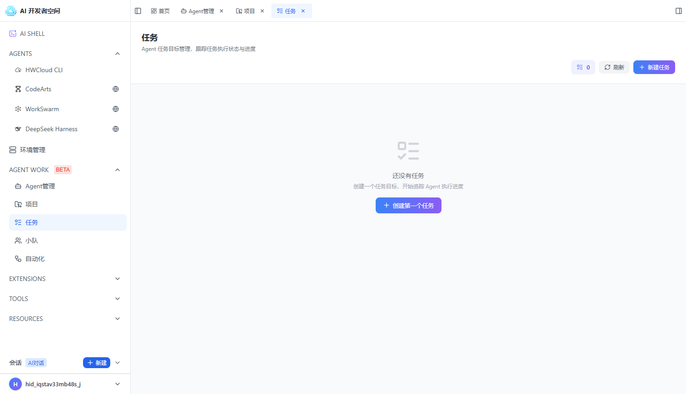

任务：创建任务目标并追踪 Agent 执行进度

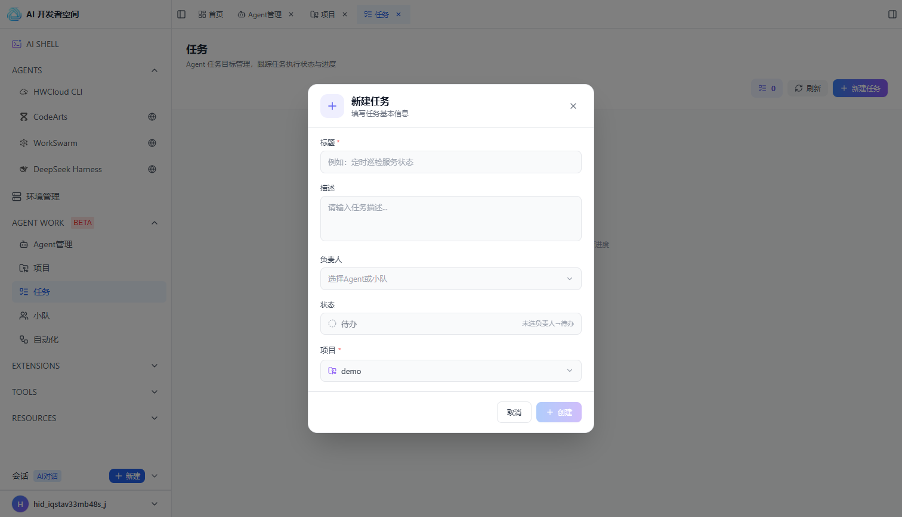

新建任务：填写标题与描述，选择负责人（Agent / 小队）、状态与所属项目

## 小队

将多个智能体组合为协作小队，由 Leader 协同完成复杂任务：

  1. 点击左侧 **AGENT WORK → 小队** 进入小队列表
  2. 点击 **\+ 创建小队** （首次使用可点击 **\+ 创建第一个小队** ），设置名称与 Leader，勾选成员，可指定审查者并填写小队介绍与协作说明
  3. 支持按小队名称、Leader 或成员搜索

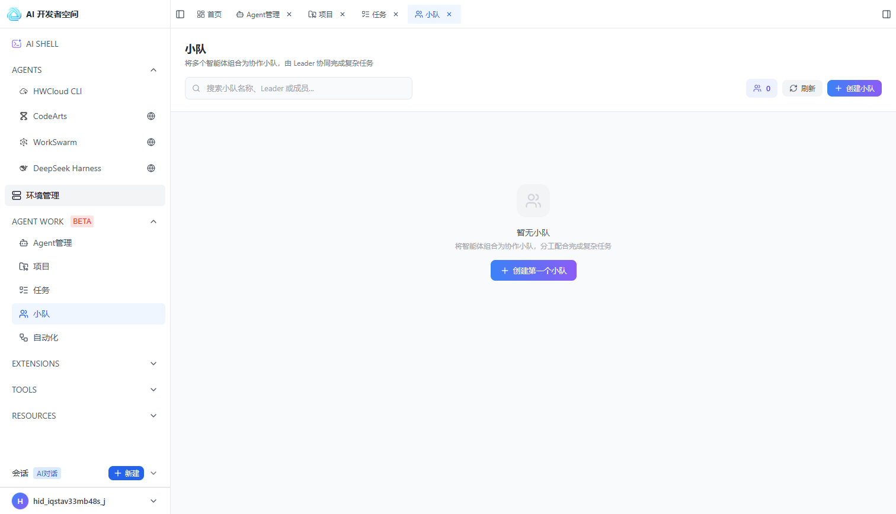

小队：多智能体协作，由 Leader 分工配合完成复杂任务

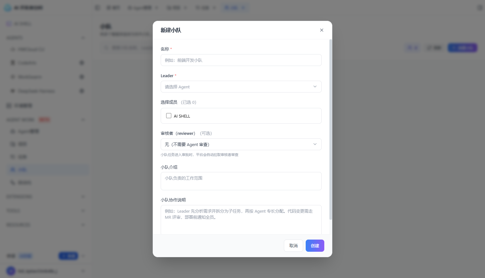

新建小队：设置名称与 Leader，选择成员与审查者，填写小队介绍与协作说明

## 自动化

为智能体或小队安排周期性任务，实现定时自动执行：

  1. 点击左侧 **AGENT WORK → 自动化** 进入自动化列表
  2. 点击 **\+ 新建** 创建自动化计划：填写计划名称与任务内容，选择所属项目与负责人，设置触发时间（支持 **高级 Cron** 表达式）
  3. 支持按名称搜索自动化任务

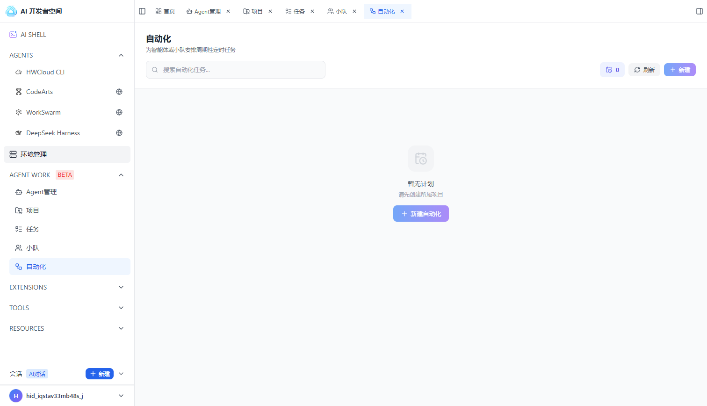

自动化：为智能体或小队安排周期性任务

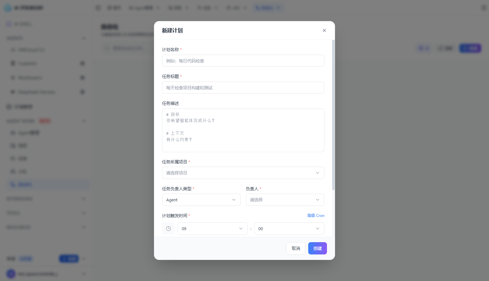

新建计划：填写计划名称与任务内容，选择所属项目与负责人，设置触发时间

## EXTENSIONS

**EXTENSIONS** 模块提供扩展能力入口，包含华为云 Skills 和 Channels 两个子模块：

子模块| 说明  
---|---  
**华为云 Skills**|  预置的华为云服务技能集合，提供云资源查询、运维等快捷能力  
**Channels**|  消息渠道连接管理，支持飞书、微信、企业微信等平台对接  
  
## 华为云 Skills

**华为云 Skills** 是技能市场，提供华为云各产品的技能（当前 79 个，可查看已安装数量）。

技能类别| 示例| 用途  
---|---|---  
昇腾 Ascend NPU| ascend-command、models-deploy| NPU 管理、模型部署、算子优化  
容器 CCE / CCI| cluster-management、metric-analyzer| 集群管理、事件分析、指标分析  
云服务器 ECS| ecs-alert、passwordless-login| 监控告警、免密登录配置  
轻量服务器 Flexus L| server-manage、deploy-WorkSwarm| 实例管理、一键部署  
对象存储 OBS| bucket-create、obs-upload| 桶创建、文件上传、静态网站托管  
数据仓库 DWS| dws-cpu-diag、sql-check| 性能诊断、SQL 检查  
资源查询| computing-query、network-query、iam-query| 查询计算 / 网络 / 存储 / 监控 / 身份资源  
技能工具| skill-creator、skill-tester、skill-audit| 技能创建、测试、审计  
  
**操作步骤：**

  1. 点击左侧 **华为云 Skills** 进入技能市场
  2. 使用顶部**搜索框** 按名称检索技能
  3. 勾选「仅显示已安装」可筛选已安装的技能
  4. 点击技能的**安装** 按钮完成安装，点击**卸载** 移除

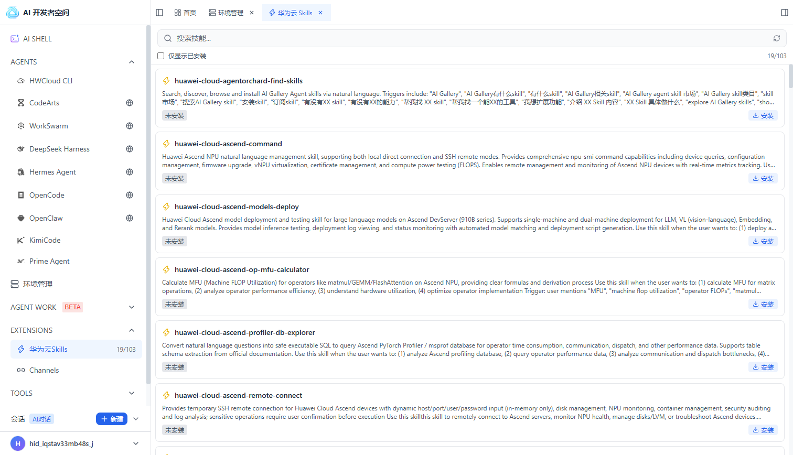

华为云 Skills 技能市场：技能搜索、安装与卸载

## Channels 渠道

**Channels** 用于连接外部消息平台。Agent 通过它收发消息，从而接入飞书、微信、企业微信等平台。

渠道| 说明  
---|---  
**飞书**|  支持消息接收、机器人回复、文档协作  
**微信**|  支持扫码登录、消息收发、配对码验证  
**企业微信**|  支持 AI 机器人扫码授权与消息收发  
  
**操作步骤：**

  1. 点击左侧 **Channels** 进入渠道列表
  2. 点击顶部「配置华为云 AKSK」，管理华为云访问凭证
  3. 选择目标渠道（飞书 / 微信 / 企业微信），点击**连接** 或**配置** 建立连接

**提示：** 每个 Channel 通过配置凭证（如 App ID、App Secret）与外部平台建立安全连接，支持扫码注册与手动配置两种方式。 

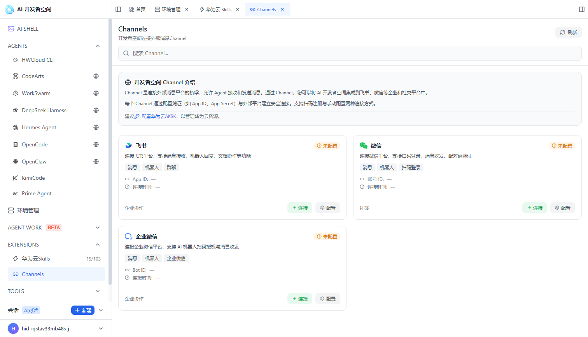

Channels 渠道：飞书 / 微信 / 企业微信连接配置

## RESOURCES

**RESOURCES** 模块提供文档与资源入口，包含开发文档站和 Agent 接入指引：

入口| 说明  
---|---  
**文档站**|  《AI 开发者空间操作指南》（本文档），查看完整的产品使用说明  
**Agent 接入**|  IACMCPServer 使用指南文档  
  
## 文档站

**文档站** 是 AI 开发者空间的官方操作指南文档，点击左侧菜单 **RESOURCES → 文档站** 即可进入。文档站涵盖以下内容：

  * AI SHELL 的使用方法（AI 对话模式、命令行模式、会话配置）
  * AGENTS 模块各智能体的操作说明（CodeArts、WorkSwarm 等）
  * 环境管理的部署与配置指引
  * 华为云 Skills 和 Channels 的接入说明
  * TOOLS 模块（OpenViking、DevBridge）的使用指南
  * RESOURCES、文件管理、设置与反馈等全部功能模块说明

**说明：** 本文档即为「文档站」所指向的操作指南，当前页面即为文档站内容。可通过左侧导航菜单快速定位到各个功能模块的使用说明。 

## Agent 接入

**Agent 接入** 提供 IACMCPServer 使用指南，指导开发者通过 MCP 协议将基础设施即代码能力接入到 AI 开发者空间。点击左侧菜单 **RESOURCES → Agent 接入** 即可跳转到 GitCode 上的 IACMCPServer 文档。

**IACMCPServer 使用指南包含以下内容：**

  * IACMCPServer 概述：通过 MCP 协议暴露云基础设施部署能力
  * 接入流程：配置 MCP 客户端（opencode、codearts、Cursor 等）
  * 能力说明：支持多云资源编排、部署、排错与销毁全流程
  * 配置说明：timeout、tool_call 等参数配置

**提示：** 点击 Agent 接入 菜单项将跳转到 GitCode（gitcode.com）上的 Hi-Tools/runtime 仓库，查看 IACMCPServer 完整使用指南。 

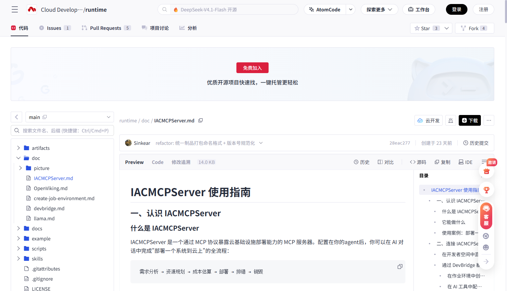

Agent 接入：IACMCPServer 使用指南（GitCode）

## 文件管理

点击右上角「展开右侧面板」，可打开文件管理器：

  * **搜索文件名** ：按名称检索文件
  * **批量操作** ：对多个文件执行批量处理
  * **上传** ：上传本地文件
  * **新建文件 / 新建文件夹** ：在工作区创建文件或目录

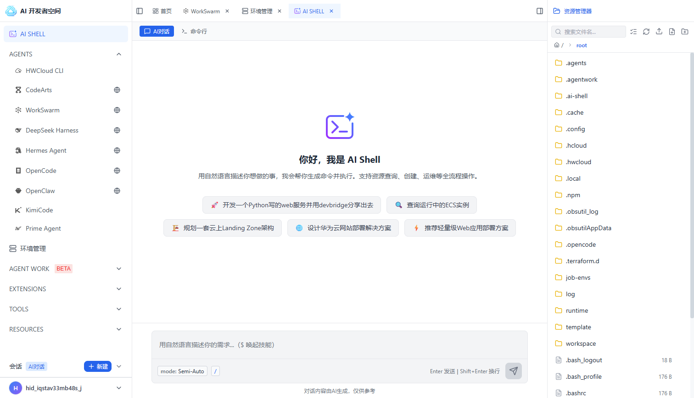

文件管理：文件搜索、上传、新建文件 / 文件夹

## 设置与反馈

入口| 功能  
---|---  
**设置**|  基本信息：账号 ID / 实名认证状态 / 账号中心；主题设置：浅色模式 / 深色模式 / 跟随设备  
**问题反馈**|  提交使用问题与意见反馈  
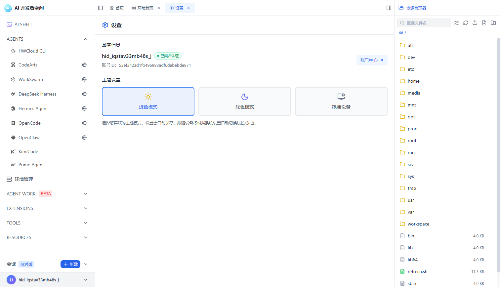

设置：基本信息与主题模式切换（浅色 / 深色 / 跟随设备）

## 系统监控

**系统监控** 用于实时查看 AI 开发者空间宿主机的资源使用情况。

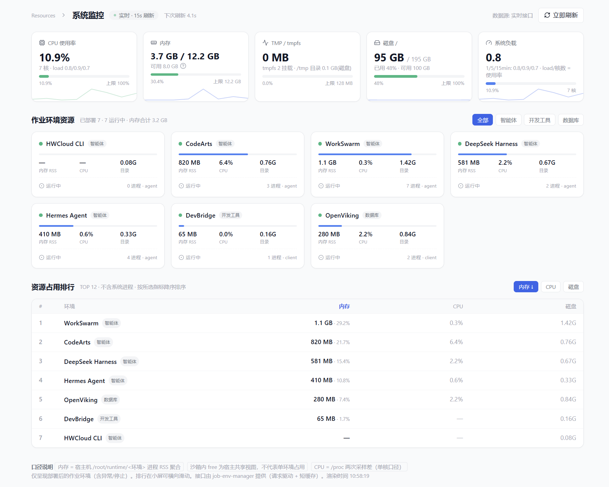

系统监控：资源概览、作业环境资源、资源占用排行与口径说明

### 操作步骤

  1. 在左侧点击个人用户名，选择 **系统监控** 进入监控页面
  2. 查看顶部 **系统资源概览** ，点击「立即刷新」按钮可实时看到最新的使用情况
  3. 在 **作业环境资源** 区域，点击 **智能体 / 开发工具 / 数据库** 标签按类型筛选
  4. 在 **资源占用排行** 区域，点击右上角 **内存 / CPU / 磁盘** 标签切换排序维度

### 系统资源概览

  * 宿主机整体资源使用情况，包含 CPU 使用率、内存、TMP、磁盘、系统负载五项指标。

指标| 展示内容  
---|---  
CPU 使用率| 当前使用率、核数、负载、使用上限及变化趋势  
内存| 已用与总量、可用内存、使用上限及变化趋势  
TMP / tmpfs| 占用大小、tmpfs 挂载数及挂载路径  
磁盘| 已用与总量、已用占比、可用空间、使用上限  
系统负载| 当前负载、1/5/15 分钟平均负载、核数及变化趋势  
  
### 作业环境资源

  * 展示所有已部署作业环境的资源占用明细。可按智能体、开发工具、数据库筛选，只查看某一类型的作业环境。
  * 每张卡片对应一个环境，展示它的内存 RSS、CPU、目录大小、运行状态和进程数。尚无数据的指标显示为"—"。

### 资源占用排行

  * 展示占用最高的 12 个作业环境，不含系统进程。可按内存、CPU、磁盘切换排序指标，按所选指标降序排序。

### 口径说明

  * 内存 = 宿主机 `/root/runtime/<环境>` 进程 RSS 聚合；CPU = `@command:proc` 两次采样差（单核口径）。数据由 job-env-manager 接口提供，页面底部标注渲染时间。

## 视频指导

通过视频快速了解 AI 开发者空间的核心功能与实操方法。
